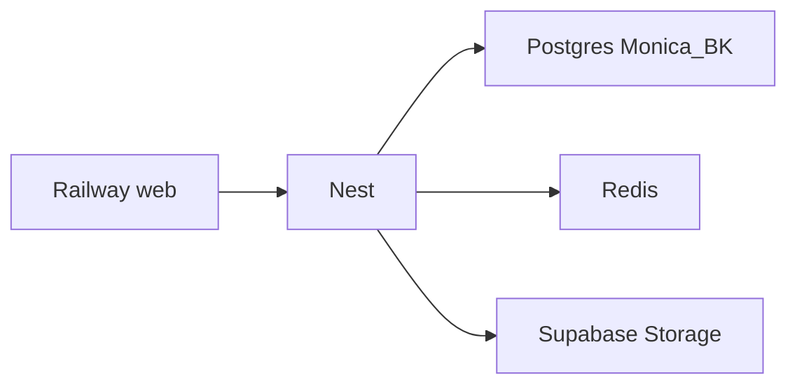

# 11 — Despliegue en Railway

El repo está preparado para un servicio web que construye el [`Dockerfile`](../Dockerfile) de la raíz. Este documento no despliega nada: el alta del servicio, las variables y el primer deploy son manuales. Ver también [`railway.toml`](../railway.toml).



La API escucha `PORT` en `0.0.0.0`. Al arrancar el contenedor corre `prisma migrate deploy` y luego `node dist/main.js`. Railway termina TLS; no uses `pnpm certs:dev` ahí.

## Start command (crítico)

La imagen de producción **no tiene pnpm**. El `CMD` del [`Dockerfile`](../Dockerfile) y el `startCommand` de [`railway.toml`](../railway.toml) son:

```bash
npx prisma migrate deploy && node dist/main.js
```

Si en el dashboard (Settings → Deploy → Custom Start Command) queda `pnpm --filter api start`, Railway **sustituye** el CMD de la imagen y el deploy falla con `The executable pnpm could not be found`.

**Qué hacer en el dashboard:** bórralo (vacío, para usar Dockerfile/`railway.toml`) o pon exactamente el comando de arriba. No uses `pnpm` ni `nest start` en producción.

## Checklist

1. En Railway, servicio desde este repo. Builder: Dockerfile (`railway.toml`).
2. Start command: vacío o `npx prisma migrate deploy && node dist/main.js` (nunca `pnpm ...`).
3. Añade un Redis (plugin de Railway o Upstash) → `REDIS_URL`.
4. Pega las variables de la tabla. No subas `.env` al repositorio.
5. Deploy. Healthcheck: `GET /api/salud/vida`.
6. Cuando Redis y Postgres respondan: `GET https://<tu-dominio>/api/salud/listo`.
7. Humo: `POST /api/v1/auth/ingreso` y, con `admin@demo.com`, el simulador de un pedido.

## Variables

| Variable | Valor típico (proyecto universitario) |
|---|---|
| `NODE_ENV` | `production` |
| `PORT` | Lo inyecta Railway. No lo fijes salvo que haga falta. |
| `DATABASE_URL` | Session pooler de Supabase (Monica_BK), puerto `5432` |
| `REDIS_URL` | Redis de Railway o Upstash |
| `JWT_SECRET` | Secreto de al menos 32 caracteres (o `JWT_KEYS`) |
| `PAYMENT_PROVIDER` | `mock` |
| `CORS_ORIGINS` | Origen del frontend, sin barra final |
| `MEDIA_DRIVER` | `supabase` |
| `SUPABASE_URL` | `https://<ref>.supabase.co` |
| `SUPABASE_SERVICE_ROLE_KEY` | Secret service_role |
| `SUPABASE_STORAGE_BUCKET` | `product-images` (créalo en Storage) |
| `SWAGGER_ENABLED` | `true` si la demo necesita `/docs`; si no, `false` |

`PAYMENT_PROVIDER=mock` deja activo el simulador de superadmin aunque `NODE_ENV` sea `production`. Wompi no está cableado. Detalle en [10-PAGOS-PASARELA.md](10-PAGOS-PASARELA.md).

## Disco e imágenes

El filesystem de Railway no persiste. No uses `MEDIA_DRIVER=local` en ese servicio: las fotos se pierden al redeploy. Con `supabase`, crea el bucket `product-images` en el proyecto de Mónica antes de subir imágenes.

## Qué no hace este repo

- No crea el proyecto en Railway ni ejecuta `railway up`.
- No guarda la contraseña de Database ni el `service_role`.
