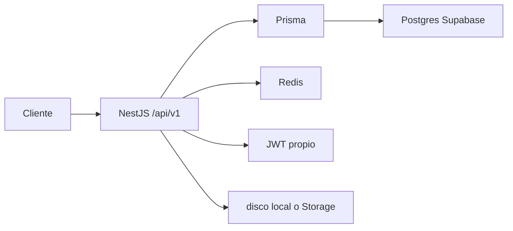

# Balance operativo — MinimalShop API

Fecha: **2026-10-22**. Rama: `chore/supabase-monica-handoff`. Contrato HTTP: [05-CONTRATO-API.md](05-CONTRATO-API.md). Conexión: [08-SUPABASE.md](08-SUPABASE.md).

## Cómo está armada

Monolito NestJS 11. Un proceso, varios módulos (`usuarios`, `catalogo`, `inventario`, `carrito`, `pedidos`, `pagos`, `notificaciones`, `reportes`, `complementarios`, `resenas`). Prefijo `/api`, versión `v1`. OpenAPI en `/docs`.

| Pieza | Dónde vive | Qué no es |
|---|---|---|
| Datos de negocio | Postgres (Prisma) | No es Supabase Auth |
| Sesión | JWT HS256 + refresh en tabla `refresh_tokens` | No usa la anon key |
| Colas y rate limit | Redis (`REDIS_URL`) | Supabase no lo incluye |
| Imágenes | `MEDIA_DRIVER=local` (disco) | Storage solo si se pone `supabase` |
| Pagos | `PAYMENT_PROVIDER=mock` o Stripe | El cliente no confirma el pago |

Prisma conecta como **owner**. Las políticas RLS no filtran al backend. La migración `fase5_hardening` quita políticas abiertas y revoca `anon` / `authenticated` para que PostgREST no lea las tablas con la clave pública.

## Roles

`COMPRADOR`, `VENDEDOR`, `SUPERADMIN`. El registro público no acepta `SUPERADMIN`. El id del usuario sale del token, no de la URL.

## Flujo de compra

1. `POST /api/v1/auth/ingreso`
2. `POST /api/v1/carrito/items`
3. `POST /api/v1/pedidos` con cabecera `Idempotency-Key` (reserva de stock ~15 min, vacía el carrito)
4. `POST /api/v1/pagos/pedidos/:id/intento`
5. Cierre: webhook de Stripe o, en mock, `POST /api/v1/pagos/simulador/pedidos/:id/aprobar` (solo superadmin, fuera de producción)
6. El vendedor avanza `PATCH /api/v1/vendedor/pedidos/:id/estado`

Estados: `CREADO` → `PENDIENTE_PAGO` → `PAGADO` → `EN_PREPARACION` → `ENVIADO` → `ENTREGADO` (también `CANCELADO` y `REEMBOLSADO`).

Seed de desarrollo (password `demo12345`): `comprador@demo.com`, `vendedor@demo.com`, `admin@demo.com`. Cupón `WELCOME10`.

## Salud

| Ruta | Significado |
|---|---|
| `GET /api/salud/vida` | El proceso responde |
| `GET /api/salud/listo` | Postgres y Redis responden |

## Quién hospeda la base

| | |
|---|---|
| Cuenta | Monica_BK |
| Proyecto | MinimalShop_API |
| Ref | `rbgidchvwvadwxuidsxj` |
| Región | `us-east-1` (East US / North Virginia) |
| Motivo | La cuenta anterior llegó al límite de proyectos activos del plan Free |

El proyecto viejo se eliminó. No había dump que restaurar: el esquema se recreó con Prisma. Los secretos de JWT, Redis, Stripe y SMTP no viajan con la cuenta de Supabase. `.env` no se versiona: cada desarrollador apunta su `DATABASE_URL` al Session pooler de este proyecto.

## Estado de la migración (2026-10-22) — listo

| Paso | Resultado |
|---|---|
| Session pooler `aws-0-us-east-1.pooler.supabase.com:5432` | OK |
| `prisma migrate deploy` (3 migraciones: init, rls_basics, fase5_hardening) | OK en Monica_BK |
| `prisma db seed` | OK (`comprador@demo.com` / `vendedor@demo.com` / `admin@demo.com`, password `demo12345`) |
| `JWT_SECRET` en raíz y `apps/api/.env` | Requerido para Nest (Prisma solo usa `DATABASE_URL`) |

La causa del `P1000` inicial fue una contraseña de Database incorrecta (el formato de la URI ya era válido). Tras resetearla en el dashboard y actualizar ambos `.env`, el deploy y el seed corrieron.

## Verificación local (misma fecha)

Contra Postgres local `minimalshop_e2e` y Redis en `127.0.0.1` (sin tocar Monica_BK):

- `pnpm test:e2e`: 7 tests OK.
- `GET /api/salud/vida` y `GET /api/salud/listo`: 200.
- Ingreso demo: 200, rol `COMPRADOR`.

## Qué queda fuera

- Copiar objetos de Storage (hoy el driver es local).
- Desplegar el proceso Nest a un host de producción: solo hay que apuntar `DATABASE_URL` y `REDIS_URL`.
- El e2e `security.e2e-spec.ts` no entra en `pnpm test:e2e` (el regex de Jest solo corre `fase5.e2e-spec.ts`) y sigue citando rutas en inglés.
